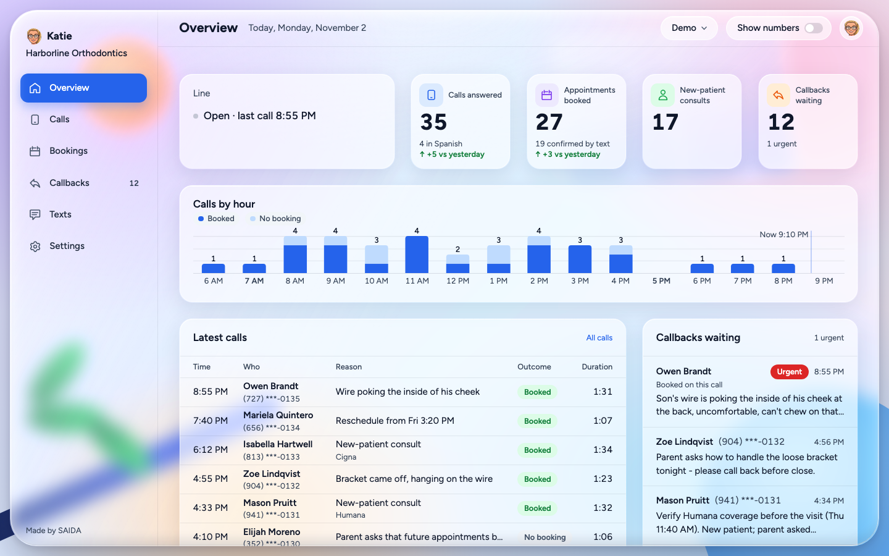
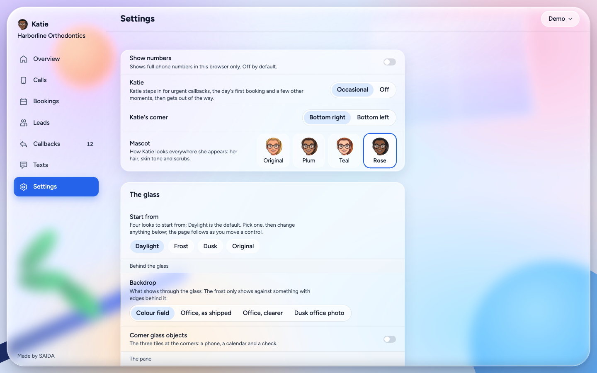
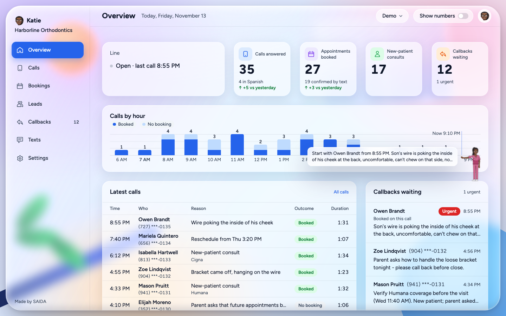

# Glass Dashboard

A dashboard for an AI phone receptionist, built to look like real glass. It shows a practice what
its receptionist, Katie, did today: calls, bookings, callbacks, texts, and the full transcript of
every call, all inside one frosted-glass pane. Everything about the glass, and Katie's own look,
can be changed live in Settings.

**Live demo: https://glass-dashboard-demo.netlify.app** (a made-up practice, no login)



## Try it

- **Settings > The glass.** Start from a preset (Daylight, Frost, Dusk, Original), then change
  what is behind the glass, the pane's fill, blur, colour boost and corner radius, the edge, the
  cards and the text size. The page follows each control as you move it, and your look is saved
  in your browser.
- **Settings > Mascot.** Pick Katie's look (hair, skin tone and scrubs). Her pop-ups, the top
  bar, the sidebar and the call transcripts all follow.
- **The Katie button** at the top right. She walks to whatever needs attention and says one
  plain sentence about it, then leaves.
- **Any call.** Opens the transcript in a side drawer.





## What made the glass hard

The first versions looked like a pale card sitting on a blue background, not glass. Before
rebuilding, the causes were researched and checked against the sources
(`docs/research/glass-lab-2026-11-02/`). What they turned out to be:

1. **The pane was too solid.** It was 72% white, more than any glass in the sources; most sit
   between 10 and 30%.
2. **Nothing sharp behind it.** The backdrop was already blurred and one colour, so the blur had
   nothing to show. The default backdrop is now a colour field with real edges.
3. **The cards' blur was dead.** An element with `backdrop-filter` becomes a backdrop root, so
   anything inside it can only see it, not the page behind. The frosted pane is now a sibling of
   the content instead of its parent.
4. **The entrance switched the blur off.** A fade-in on opacity disables the blur while it plays,
   so the entrance only moves.
5. **Safari ignores `var()` inside `backdrop-filter`** (WebKit bug 297620), so the blur is written
   inline.
6. **The type looked thin.** The design system sets antialiased font smoothing, which leaves about
   12% less ink on a Mac and shows most on a non-Retina screen. Text is crisp by default and a
   little larger.

The shipped glass is section 9 of `docs/DESIGN-GLASS.md`.

## The mascot looks

Katie is a rigged drawing: the head and torso are artwork, and the arms, hands and legs are drawn
in SVG so she can walk, point and wave. The other looks are her own art recoloured by
`scripts/mascot-looks.mjs`, which finds the hair, skin and scrub colours by hue, keeps the
shading, and writes the matching colours for the drawn parts, so the arms always match the face.

## How it was built

I built this with Claude Code as the coding agent. I set the direction, sent back the versions
that didn't look right, had the glass researched and the findings checked before the rebuild, and
tuned the final look by eye. Two scripts check the work:

- `node scripts/check-lib.mjs` runs 2,737 checks on the app's logic.
- `node scripts/verify.mjs` drives the app in a real browser with Playwright: each of Katie's
  moments, screenshots of every page, the browser console, Lighthouse and a performance trace.

## Stack

React 18, TypeScript (strict), Vite 8, monday.com's Vibe design tokens, TanStack Query, and GSAP
for Katie's motion. The demo runs entirely in the browser on made-up data; the real version reads
a private API (`/api/dash/*`) on the same origin, which is not part of this repo.

## Run it

```sh
npm install
npm run dev:demo      # then open http://localhost:5173/dash/
npm run build:demo    # the static demo site: the app lands in dist-demo/dash/
```

## Where things are

| | |
|---|---|
| `src/settings/look.ts`, `src/pages/settings/LookCard.tsx` | the glass settings |
| `src/styles/glass.css` | the glass itself |
| `src/katie/` | Katie: the rig, her motion, and when she shows up |
| `src/katie/mascot.ts`, `scripts/mascot-looks.mjs` | the mascot looks |
| `docs/DESIGN-GLASS.md` | the glass, pass by pass |
| `docs/ENGINEERING.md` | the full engineering notes |
| `docs/CONTRACTS.md` | the code map |
| `brief/PROMPT.md` | the original brief |

Every practice, name, phone number and call in this repo is made up.
